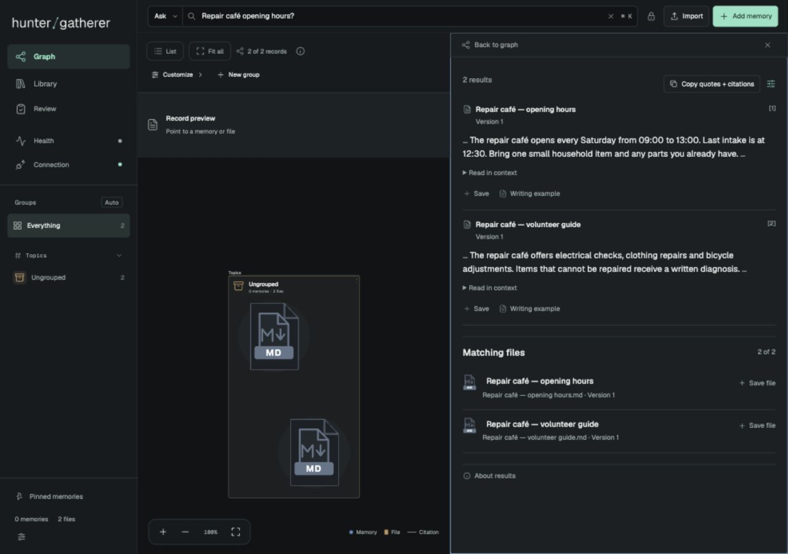

<h1></h1>

**Your data, AI-native.** Ask your library. Inspect the evidence. Give your assistant the sources.

[](https://github.com/awpri/hunter-gatherer/actions/workflows/packaged-demo.yml)
[](https://github.com/awpri/hunter-gatherer/releases/tag/v0.1.0a1)
[](LICENSE)
[](pyproject.toml)
[](docs/mcp.md)

[**Get started**](docs/getting-started.md) · [**Terminal guide**](docs/cli.md) · [**Documentation**](docs/index.md) · [**Connect an assistant**](docs/mcp.md) · [**Contribute**](CONTRIBUTING.md)

hunter/gatherer (h/g) is a local evidence library for documents, files and memories.
Ask a question in the graph's search bar and read exact excerpts from your sources.
Open the original, copy quotations with citations, or keep an investigation in a
collection. Your AI assistant can use the same library through MCP.



[What's in this alpha →](CHANGELOG.md)

## From a question to its sources

| What you need | What h/g gives you |
| --- | --- |
| Find a detail across your files | Question search with quotations, source links and expandable context. |
| Check where an answer came from | Preserved document versions, passage citations and original PDF pages and regions. |
| Follow an investigation | Graph and list views, saved connections, collections, notes and unresolved questions. |
| Give an assistant useful context | Six MCP tool families for finding, opening, remembering, collecting, importing and checking status. |
| Work from the terminal | `hunt ask` for cited quotations, `hunt open` for context, and JSON for scripts and agents. |
| Keep control of your library | Local storage, import review, privacy controls, backup and restore, themes and motion preferences. |

Ask retrieves evidence; it does not generate an answer. Use your existing
assistant to reason over inspected sources. Search can miss relevant text, and
highlighting does not establish that a quotation answers the question. This is
an **alpha**; see [feature scope and limitations](docs/faq.md).

## Install and create your library

You need **Python 3.11 or newer** and Git. The bundled interface runs without Node.
Install the tagged alpha in its own environment:

```bash
git clone --branch v0.1.0a1 --depth 1 https://github.com/awpri/hunter-gatherer.git
cd hunter-gatherer
python3 -m venv .venv
.venv/bin/python -m pip install .
.venv/bin/hunt init ./my-library
.venv/bin/hunt serve ./my-library --port 8767
```

Open [localhost:8767](http://127.0.0.1:8767/), import files, and ask a question.
The directory must be new or empty when you run `init`; reuse `serve` to restart.
The default library works offline with keyword search and lightweight hashing.
It needs no model key, neural-model download, Torch or Qdrant. Add
[optional features](docs/getting-started.md#optional-features), including semantic
search, only when you need them. Installing Python packages uses the network.

[Windows, uv, release assets and setup details →](docs/getting-started.md)

## From your terminal

With the environment activated, import a file and ask about its contents:

```bash
hunt import ./notes.md --library ./my-library
hunt ask "What did we decide about the launch?" --library ./my-library
hunt ask "What did we decide about the launch?" --server http://127.0.0.1:8767 --json
hunt setup
```

`--server` reuses a running library and any model it has loaded. `--json` returns
structured evidence for software; it does not turn on an answering model.
`hunt open` follows a citation to its exact source. See the [terminal guide](docs/cli.md).

Prefer a ready-made example before importing files?

```bash
hunt demo create ./demo-library
hunt ask "Is the Lantern pilot real?" --demo-library ./demo-library
hunt demo serve ./demo-library --port 8768
```

The [Lantern demo](docs/demo.md) is entirely fictional and has its own database.

## Install with your AI assistant

Copy this prompt into an assistant with terminal access:

```text
Install hunter/gatherer v0.1.0a1 from https://github.com/awpri/hunter-gatherer
using that tag's README and docs/getting-started.md. Check my OS, Git and Python
first. Use a new checkout and dedicated .venv; prefer uv if already installed,
otherwise use Python 3.11+ and pip inside that environment. Install the base
package only. Do not use sudo/global pip, modify shell startup files, replace an
existing installation, or read/migrate an existing personal library or ProHarness
configuration. If the tag or repository is unavailable, stop and explain; do not
substitute another package or silently install a different version.

Run hunt setup. Create a new fictional demo directory and verify hunt ask
"What is the Lantern pilot's weekly review schedule?" in readable and JSON modes
using --demo-library. Show the actual result and installed version/commit.
Then create a separate empty library with hunt init, start hunt serve on an
available loopback port, and give me its URL, exact restart command and how to
stop it. Let me choose files to import. Ask before adding optional features,
downloading model weights or changing existing configuration.
```

## Documentation

- [Using the library](docs/usage.md) — Ask, graph exploration, citations and collections.
- [Terminal usage](docs/cli.md) — library selection, imports, source inspection and JSON.
- [MCP integration](docs/mcp.md) — connect an assistant through the six-tool interface.
- [Questions and feature scope](docs/faq.md) — search, privacy, writing examples and optional AI components.
- [Roadmap](docs/roadmap.md) — priorities and deferred features.
- [Release verification](docs/public-release-guide.md) — packaging and the source export boundary.

The [CI matrix](https://github.com/awpri/hunter-gatherer/actions/workflows/packaged-demo.yml)
checks packaged installs on Linux, macOS and Windows with Python 3.11–3.14.
Use the exact tag's results and release notes when evaluating this alpha.
GitHub is the release channel; there is no h/g PyPI or Homebrew release yet.

## Contributing

Bug reports, suggestions and forks are welcome. Pull requests are by invitation
only; [open an issue](https://github.com/awpri/hunter-gatherer/issues/new/choose)
to discuss a change before submitting one. Reviews and support are provided as
time permits. See [CONTRIBUTING.md](CONTRIBUTING.md) and [SECURITY.md](SECURITY.md).

## License

[Apache License 2.0](LICENSE). See [NOTICE](NOTICE) for attribution and bundled
third-party notices. h/g is developed separately from the original ProHarness
installation. Personal libraries and configuration are not included in this repository.
